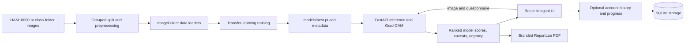

# SkinAI

### Bilingual skin-lesion pre-screening for a more informed conversation with a clinician

**SkinAI** is a portfolio project exploring how computer vision and thoughtful product design can make skin-health information easier to approach. It combines a lesion image with questionnaire context, presents model-ranked possibilities and urgency guidance, and creates a report a person can bring to a qualified clinician.

The project is designed for **education, experimentation, and technical demonstration**. It is not a medical device, does not diagnose, and must not be used to make treatment decisions or delay care.

[**skin-ai-psi-two.vercel.app**](https://skin-ai-psi-two.vercel.app/) · [Deployment guide](DEPLOYMENT.md) · [API documentation while running](http://127.0.0.1:8000/docs)


## Why this project

Skin conditions can be difficult to describe, and access to specialist care is not equal everywhere. SkinAI explores a responsible way to help people organize what they notice and prepare questions for a clinical visit, with an interface available in English and Arabic.

That is a **project goal, not a measured health outcome**. The model and its questionnaire rules have not been clinically validated. SkinAI does not claim to improve diagnostic accuracy, replace a dermatologist, or provide a diagnosis.

## What it does

- Accepts a JPEG, PNG, or WebP image and checks basic file, size, resolution, and sharpness constraints.
- Uses a PyTorch image classifier and a branching questionnaire to present image-only and context-adjusted model scores.
- Displays an urgency message, image-quality caveats, and a Grad-CAM visualization of image regions that influenced the model.
- Produces a branded English or Arabic PDF summary for discussion with a clinician, with bundled Arabic fonts and text shaping.
- Provides an English/Arabic interface with right-to-left layout for Arabic.
- Offers optional account-based summary history and dated skin-progress notes, with controls to delete saved entries or the account. Saved account summaries do not include the uploaded image; progress notes should use a nickname and avoid identifying details.
- Includes a bilingual, source-linked skincare assistant with local retrieval and optional, visitor-opted-in Hugging Face generation. The assistant is educational and not personalized medical advice.

> **Model scope:** a standard HAM10000 checkpoint contains seven dermoscopic lesion classes: `akiec`, `bcc`, `bkl`, `df`, `mel`, `nv`, and `vasc`. Acne is not one of those model classes. The acne guide is separate from image classification. Actual supported labels are read from the selected checkpoint.

> **Demo mode:** if the configured model checkpoint is unavailable, the API starts with deterministic placeholder predictions so the user interface can be explored. Demo scores have no clinical meaning.

## Technology

| Area | Technologies |
|---|---|
| Machine learning | Python 3.13 target, PyTorch 2.6+, torchvision 0.21+, transfer learning, Grad-CAM |
| Data and evaluation | ImageFolder, NumPy, pandas, scikit-learn, SciPy, Matplotlib |
| Image processing | OpenCV, Pillow |
| API | FastAPI, Pydantic, Uvicorn, SQLite, ReportLab |
| Web application | React 18, TypeScript, Vite, Tailwind CSS, Lucide |
| Localization | English and Arabic, RTL support, Cairo Arabic font |
| Hosting setup | Vercel static frontend, separately hosted FastAPI model service |

The dependency ranges are maintained in [`requirements.txt`](requirements.txt), [`environment.yml`](environment.yml), and [`frontend/package.json`](frontend/package.json). Install a mutually compatible PyTorch and torchvision build for your operating system and accelerator; use the [official PyTorch installer selector](https://pytorch.org/get-started/locally/) when choosing a CUDA build.

## Architecture



### Repository map

```text
skin-ai/
├── ml/
│   ├── prepare_dataset.py   # Index, group-split, leakage check, preprocess
│   ├── dataset.py           # ImageFolder datasets and PyTorch data loaders
│   ├── models.py            # EfficientNet and ResNet model builders
│   ├── preprocessing.py     # Shared training/inference image pipeline
│   ├── train.py             # Head training and full fine-tuning
│   ├── evaluate.py          # Held-out metrics and calibration metadata
│   ├── export_safetensors.py # Export a trusted checkpoint for deployment
│   └── classes.py           # Human-readable class metadata
├── backend/
│   ├── app/main.py          # FastAPI routes, auth, records, assistant
│   ├── app/assistant.py     # Bilingual source retrieval and optional grounded generation
│   ├── app/inference.py     # Checkpoint loading, inference, Grad-CAM
│   ├── app/quiz.py          # Questionnaire and context/urgency rules
│   ├── app/records.py       # SQLite account summaries and progress entries
│   ├── app/report.py        # ReportLab PDF reports and acne guide
│   └── tests/test_api.py    # API and edge-case tests
├── frontend/
│   ├── src/App.tsx          # Application flow and /assistant route
│   ├── src/pages/AssistantPage.tsx # Standalone assistant page
│   ├── src/i18n.tsx         # English/Arabic strings and document direction
│   ├── src/api.ts           # API requests and shared types
│   ├── src/components/      # Feature panels, shared header and linked footer
│   └── public/             # Favicon, sitemap, robots, social preview
├── models/                  # Local checkpoint and generated metadata
├── data/                    # Local source and processed datasets
├── reports/                 # Generated training/evaluation outputs
├── vercel.json              # Frontend build, SPA routing, security headers
└── DEPLOYMENT.md            # Vercel and FastAPI hosting instructions
```

## Getting started

### Requirements

- Python 3.13 and Conda, or another isolated Python environment.
- Node.js 20 and npm.
- A compatible PyTorch/torchvision installation. GPU use is optional; CPU inference/training is possible but training can be slow.
- A local trained checkpoint for real predictions. Without it, the app uses demo mode.

Create the Python environment and install frontend dependencies from the repository root:

```bash
conda env create -f environment.yml
conda activate skin-ai
npm --prefix frontend ci
```

On Windows PowerShell, the commands above work from the project root. If Conda environment creation cannot find a compatible PyTorch wheel for your platform, create the Python environment first and install the matching `torch`/`torchvision` pair using the official selector, then install the remaining dependencies:

```powershell
python -m pip install -r requirements.txt
npm --prefix frontend ci
```

### Run locally

Start the API in one terminal at the repository root:

```bash
python -m uvicorn backend.app.main:app --reload --port 8000
```

Start the web app in a second terminal:

```bash
npm --prefix frontend run dev
```

Open [http://localhost:5173](http://localhost:5173). Vite proxies local `/api` requests to `http://127.0.0.1:8000`. FastAPI's interactive API docs are available at [http://127.0.0.1:8000/docs](http://127.0.0.1:8000/docs).

To create an optimized frontend build:

```bash
npm --prefix frontend run build
```

The generated site is written to `frontend/dist/`.

## Dataset preparation and model training

Dataset files and model weights are local assets; they are intentionally excluded from Git. Obtain the dataset under its applicable terms and do not commit patient images or large checkpoint files.

### HAM10000 layout

Put `HAM10000_metadata.csv` and the image files anywhere beneath `data/raw/`. The indexer matches metadata `image_id` values to image filenames and uses `lesion_id` to keep images of the same lesion in one split.

```bash
python -m ml.prepare_dataset --source ham10000
```

### Class-folder layout

For other image collections, put each label in a top-level directory. Use consistent labels and keep appropriate dataset provenance and permissions.

```text
data/raw/
├── label_one/
│   ├── image-001.jpg
│   └── image-002.jpg
└── label_two/
    ├── image-003.jpg
    └── image-004.jpg
```

```bash
python -m ml.prepare_dataset --source folders --min-per-class 30
```

The folder workflow groups identical or near-identical images using a perceptual hash. Use patient or lesion identifiers when available; perceptual hashes cannot guarantee that all related clinical images stay together.

The preparation script creates `train/`, `val/`, and `test/` ImageFolder trees beneath `data/processed/` and records assignments in `data/splits.csv`. It uses grouped, stratified splits and checks for overlap. Preprocessing is shared between preparation and inference. Training augmentation is applied only to the training loader. Verify the resulting split counts and class coverage before training.

### Train and evaluate

```bash
# EfficientNet-B3 default image size is 300 pixels.
python -m ml.train --arch efficientnet_b3 --img-size 300 --batch 32

# Lighter alternatives; choose image size and batch for available memory.
python -m ml.train --arch efficientnet_b0 --img-size 224 --batch 32
python -m ml.train --arch resnet50 --img-size 224 --batch 32

# Evaluate the selected checkpoint on the held-out test split and fit temperature
# scaling using validation logits.
python -m ml.evaluate
```

Supported architectures in `ml/models.py` are `efficientnet_b0`, `efficientnet_b3`, `efficientnet_b4`, and `resnet50`. Training selects `models/best.pt` using validation macro-F1. Evaluation writes metrics/plots under `reports/` and calibration metadata to `models/meta.json`. Keep the test split held out while tuning the model.

Local training produces `models/best.pt`. The Hugging Face deployment bundle uses `models/best.safetensors`, exported from the trusted checkpoint with `python -m ml.export_safetensors models/best.pt deploy/huggingface-space/models/best.safetensors`. The service prefers `best.safetensors` when it exists and retains safe `weights_only=True` loading for legacy `.pt` checkpoints. Never load an untrusted PyTorch checkpoint.

## API overview

| Method | Endpoint | Purpose |
|---|---|---|
| `GET` | `/api/health` | API and model status, including demo mode |
| `GET` | `/api/quiz` | Questionnaire definition |
| `POST` | `/api/analyze` | Analyze a multipart image and optional questionnaire answers |
| `GET` | `/api/report/{analysis_id}` | Download an analysis PDF while its report is retained |
| `GET` | `/api/reports/acne-guide?language=en` | Download the educational acne-care PDF (English) |
| `POST` | `/api/auth/register` | Create an account and session |
| `POST` | `/api/auth/login` | Sign in and receive an HttpOnly session cookie |
| `GET` | `/api/auth/me` | Read the signed-in account |
| `POST` | `/api/auth/logout` | Clear the browser session cookie |
| `GET`, `POST`, `DELETE` | `/api/history` and `/api/history/{analysis_id}` | List, save, and remove summary records |
| `GET`, `POST`, `DELETE` | `/api/progress` and `/api/progress/{entry_id}` | List, add, and remove dated progress notes |
| `POST` | `/api/assistant/chat` | Get a bilingual retrieved response with sources and optional consent-based generation |
| `GET` | `/api/assistant/guide/{topic}?language=en` | Read a localized, source-linked education guide from the retrieval knowledge base |

Analysis accepts `image` and an optional JSON-object `answers` form field. The API validates media type, upload size, image dimensions, decodability, blur, and model output. Low-confidence predictions from a trained model are rejected with an explanatory message; this does **not** guarantee detection of non-skin images or every out-of-scope input.

The report stores temporary prediction data, including processed image and Grad-CAM data, under `storage/` for the configured retention period (24 hours by default). The original uploaded file is not saved as an original. Account history stores a compact result summary; progress notes and account records are stored in SQLite. See [Privacy and limitations](#privacy-and-limitations) before using real personal information.

## English and Arabic

The language switch is available in the shared header on the dashboard and standalone assistant page. SkinAI remembers the selection in the browser; Arabic sets the document direction to RTL and uses the Cairo typeface. English uses the Latin UI font stack. The questionnaire, main user flows, model summaries, account/API errors, and assistant responses are localized.

The primary analysis PDF and the separate acne-care PDF are currently English-language documents. The assistant uses a curated local bilingual retrieval set with source links; if `HF_TOKEN` and `SKINAI_ASSISTANT_MODEL` are configured, visitors can explicitly opt in to grounded generation. Chat history is transient and is not saved to the account. SkinAI does not provide individualized diagnoses.

## Configuration

| Variable | Purpose | Default / guidance |
|---|---|---|
| `SKINAI_MODEL` | Optional model checkpoint path | Deployment prefers `models/best.safetensors`, then `models/best.pt` |
| `SKINAI_META` | Calibration metadata path | `models/meta.json` |
| `SKINAI_STORAGE` | Temporary reports and default account database directory | `storage/`; use a persistent private volume in deployment |
| `SKINAI_DB` | Optional SQLite database path | `storage/skinai.sqlite3` |
| `SKINAI_RETENTION_HOURS` | Temporary report cleanup period | `24` |
| `SKINAI_MAX_IMAGE_PIXELS` | Maximum decoded image pixel count | `24000000` |
| `SKINAI_LOW_CONFIDENCE_THRESHOLD` | Minimum raw model confidence before rejection | `0.35`; this is not a clinical threshold |
| `SKINAI_CONTEXT_STRENGTH` | Questionnaire influence on displayed adjusted probabilities | `0.6`; heuristic and not clinically validated |
| `SKINAI_CORS` | Comma-separated allowed browser origins | Local Vite origins by default; set the exact production frontend origin |
| `SKINAI_ENV` | Environment mode | Use `production` for deployed API |
| `SKINAI_JWT_SECRET` | JWT signing secret | Required in production; set via the host's secret manager |
| `HF_TOKEN` | Optional Hugging Face Inference Providers credential | Leave unset for local retrieval-only assistant responses; store as a Space secret if enabling generation |
| `SKINAI_ASSISTANT_MODEL` | Optional chat-completion model ID available through Hugging Face Inference Providers | Leave unset to disable external generation |
| `SKINAI_COOKIE_SECURE` | Require HTTPS for session cookie | Defaults to `true` in production |
| `VITE_API_URL` | Optional API base URL compiled into frontend | Leave unset to use local Vite proxy / production Vercel rewrite |

See [`frontend/.env.example`](frontend/.env.example) for the frontend variable format. Never commit real secrets or private environment files.

## Deploying the portfolio application

The production frontend is [https://skin-ai-psi-two.vercel.app/](https://skin-ai-psi-two.vercel.app/). Vercel serves React and proxies `/api` to the Hugging Face Space bundle in [`deploy/huggingface-space/`](deploy/huggingface-space/). Hugging Face Space storage is ephemeral by default, so account/history data can be lost when the Space restarts or rebuilds; use an external durable database before relying on persistence.

1. Import this repository into Vercel and use the repository root as the project root.
2. The included [`vercel.json`](vercel.json) sets the frontend install/build commands, publishes `frontend/dist`, handles SPA paths, and configures basic browser security headers.
3. Leave `VITE_API_URL` unset. The Vercel rewrite proxies `/api` to the backend origin and keeps session requests same-origin.
4. Deploy `deploy/huggingface-space/` to the Gradio Space `nouranomar/skin-ai-backend`, select Python 3.12 and ZeroGPU hardware, and set production secrets as documented in [`DEPLOYMENT.md`](DEPLOYMENT.md). The bundle includes `models/best.safetensors`; keep it tracked with Git LFS.
5. Hugging Face Space local storage is ephemeral; connect a durable external database before relying on saved history in production. Follow [`DEPLOYMENT.md`](DEPLOYMENT.md) for the deployment checklist.
6. After deployment, verify `/api/health`, sign-in, analysis, PDFs, CORS, and the SEO files (`/robots.txt`, `/sitemap.xml`, `/favicon.svg`, `/og-skinai.png`). Confirm canonical and social URLs match the final production domain.

The requested hostname was written without `.app`; this README uses the verified `.vercel.app` deployment hostname. Vercel's generated project domains use the `.vercel.app` suffix ([Vercel domain documentation](https://vercel.com/docs/domains/working-with-domains)).

## Privacy and limitations

- SkinAI is experimental educational software, not a diagnosis, a medical device, or a substitute for a dermatologist. Seek professional care for changing, bleeding, painful, or concerning lesions regardless of model output.
- HAM10000 contains dermoscopic images. A model trained on that dataset may not generalize to phone photos, different clinics, devices, populations, or skin tones. Public datasets also have representation limits.
- A confidence score is not a probability that a person has a disease. Context adjustment and urgency rules are heuristics and require clinical validation.
- The image classifier may not recognize out-of-scope inputs and can make confident mistakes. Blurry checks and confidence thresholds are limited safeguards, not content validation.
- The seven standard HAM10000 labels do not include acne. Acne content is general self-care education only; it does not interpret a photo as acne or recommend a personalized treatment.
- The app has not completed prospective validation, an equity/bias audit, or regulatory review. Do not present it as clinically validated.
- Temporary analysis reports include processed image data and are purged after the configured retention period. The report endpoint currently uses an unguessable analysis ID and does not require sign-in, so treat that ID like a temporary private link. Saved account summaries and progress notes persist in SQLite until removed; the current interface does not provide account-wide deletion. SQLite is not encrypted at rest by this application. Do not enter identifying details or use real patient records in a public demo.
- Production use requires a security and privacy review, durable access-controlled storage, retention/deletion policies, abuse controls, clinician review, and legal/regulatory assessment for the target jurisdiction.

## Acknowledgements

The data pipeline supports the HAM10000 dataset, described by Tschandl, Rosendahl, and Kittler in *The HAM10000 dataset, a large collection of multi-source dermatoscopic images of common pigmented skin lesions* ([Scientific Data, 2018](https://doi.org/10.1038/sdata.2018.161)). Check the dataset's original terms and attribution requirements before use.

---

**Built as a portfolio project in applied machine learning, full-stack engineering, and responsible health technology.**
